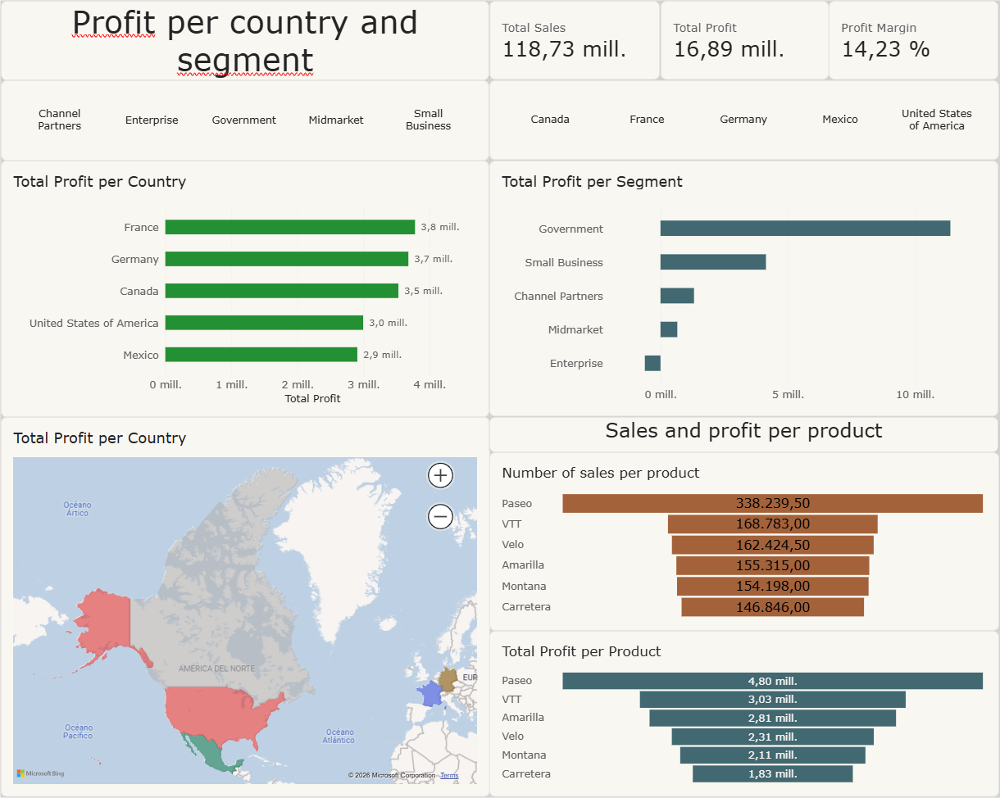

# Sales and Profit Analysis | Power BI
 
A personal data analysis project created with Microsoft Power BI. This report explores sales and profit by country, customer segment, and product, presenting the main results in an interactive dashboard.

## Preview



## What the report shows

- Summary KPIs for total sales, total profit, and profit margin.
- Profit comparisons by country and customer segment.
- Geographic distribution of results using a map.
- Sales and profit comparisons by product.
- Interactive country and segment filters to explore the data.

The figures in the screenshot reflect the view shown and may change when filters are applied.

## Skills demonstrated

This project demonstrates basic Power BI skills: arranging a report page, combining KPI cards and visualizations, presenting geographic data, and enabling data exploration with filters. The `.pbix` file can be opened in Power BI Desktop to review the report.

## Open the project

1. Download or clone this repository.
2. Open `analisis-ventas-beneficios.pbix` with Power BI Desktop.
3. If Power BI requests access to the data source, follow the application prompts to refresh it. The included screenshot shows the report without opening the file.

## Project structure

```text
.
├── analisis-ventas-beneficios.pbix
├── images/
│   └── vista-previa-informe.png
└── README.md
```

## Tools

- Microsoft Power BI Desktop
- Visualizations, KPI cards, filters, and map

---

# Análisis de ventas y beneficios | Power BI

Proyecto personal de análisis de datos creado con Microsoft Power BI. El informe explora ventas y beneficios por país, segmento de cliente y producto, y presenta los principales resultados en un panel interactivo.

## Vista previa


## Qué muestra el informe

- Indicadores resumidos de ventas, beneficio total y margen de beneficio.
- Comparación del beneficio por país y por segmento.
- Distribución geográfica de los resultados mediante un mapa.
- Comparación de ventas y beneficios por producto.
- Filtros interactivos por país y segmento para explorar los datos.

Las cifras de la captura corresponden a la vista mostrada y pueden cambiar al aplicar filtros.

## Conocimientos demostrados

Este proyecto sirve como muestra de conocimientos básicos de Power BI: organizar una página de informe, combinar indicadores y visualizaciones, representar datos geográficos y facilitar la exploración mediante filtros. El archivo `.pbix` permite abrir el informe y revisar su contenido en Power BI Desktop.

## Abrir el proyecto

1. Descarga o clona este repositorio.
2. Abre `analisis-ventas-beneficios.pbix` con Power BI Desktop.
3. Si Power BI solicita acceso al origen de datos, sigue las indicaciones de la aplicación para actualizarlo. La captura incluida permite consultar el aspecto del informe sin abrir el archivo.

## Estructura del proyecto

```text
.
├── analisis-ventas-beneficios.pbix
├── images/
│   └── vista-previa-informe.png
└── README.md
```

## Herramientas

- Microsoft Power BI Desktop
- Visualizaciones, tarjetas de indicadores, filtros y mapa
